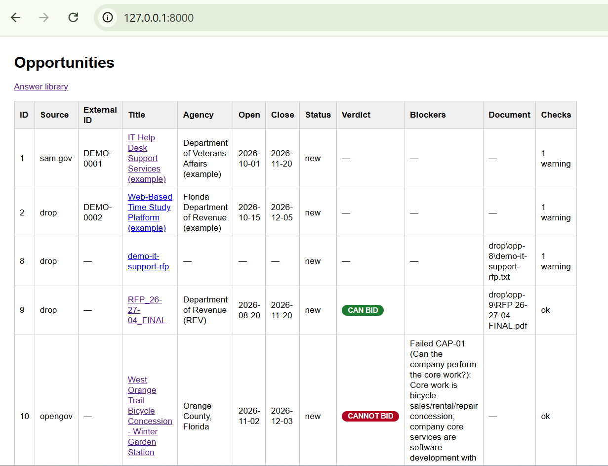
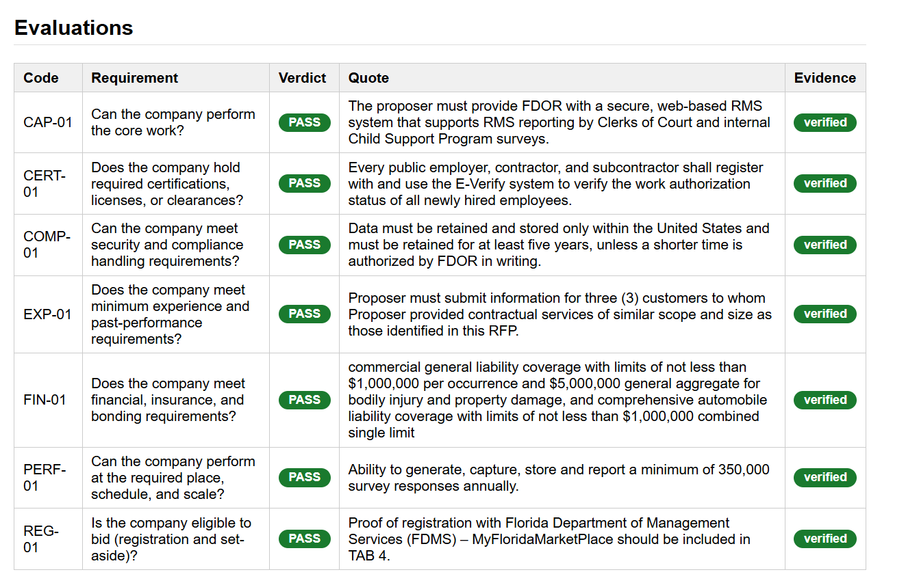
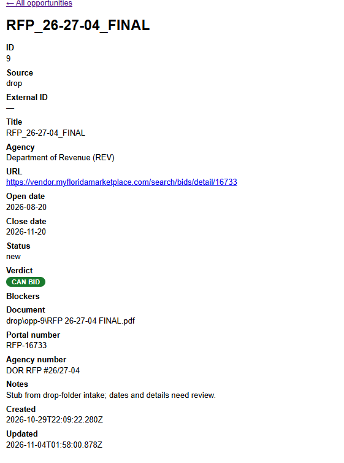
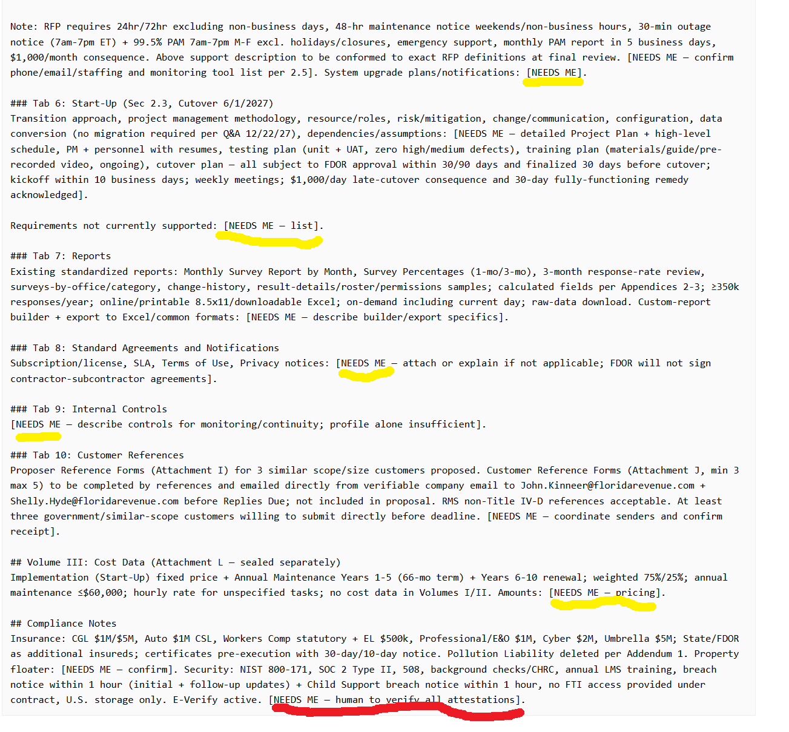

# SmallBiz Rainmaker AI
### Powered by Meta Muse Spark

**Let AI Be Your Rainmaker. Turn Opportunities into Deals.**

*From complex government solicitations to evidence-backed bid decisions and tailored proposal drafts.*

Government contracting is full of opportunity. But small businesses face a major disadvantage: large corporations have dedicated teams to evaluate opportunities and write proposals, while smaller businesses often have to do everything themselves.

**SmallBiz Rainmaker AI helps level the playing field.**

Powered by Meta Muse Spark, this local-first AI assistant reviews complete solicitation packages, compares their requirements against a company's documented capabilities, and recommends whether to pursue an opportunity.

When the opportunity is a good fit, it generates a tailored proposal draft and identifies everything that still requires human review.

**We don't just generate proposals. We help small businesses pursue the right opportunities and get more busine$$e$.**

## Watch the 3-minute demo

**[▶ Watch the end-to-end demonstration](https://youtu.be/m0e81Kdc9Ek)**

See a real government solicitation move from document ingestion to AI evaluation, verified evidence, and a structured proposal draft.





## Meta Muse in Action: 15 Documents, One Analysis

In our live test, Proposal Creator processed a Florida Department of Revenue solicitation containing 15 documents—including the original RFP, appendices, amendments, and Q&A materials.

Rather than analyzing each document in isolation, **Meta Muse reads the combined readable package in a single large-context model call**, allowing it to reason across the solicitation and the company's capabilities.

### Verified demonstration results

| Metric | Result |
|---|---|
| Government procurement sources | OpenGov + MyFloridaMarketPlace |
| Documents in tested solicitation | 15 |
| Draft-generation input tokens | 93,569 |
| Draft-generation total tokens | 96,919 |
| Eligibility decision | CAN BID |
| Output | Proposal draft + commitments checklist |
| Human oversight | Required before submission |

## What Makes It Different

- **Bid/no-bid intelligence:** Evaluates whether a company's capabilities match the solicitation before drafting begins.
- **Large-context reasoning with Meta Muse:** Processes complete readable solicitation packages, including supporting documents, in one model call.
- **Evidence you can verify:** Checks AI-generated quotations against the original solicitation text. Unsupported quotations are rejected rather than presented as verified evidence.
- **Two real procurement integrations:** Retrieves solicitation information and documents from OpenGov and MyFloridaMarketPlace.
- **Solicitation-specific proposal drafting:** Uses the RFP requirements, company profile, and saved company answers to prepare a structured response.
- **Human-in-the-loop safeguards:** Flags missing commitments, confirmations, and required information. The application never submits a bid automatically.

## Two Solicitations. Two Different Decisions.

Using the same fictional demonstration company, Broward Technology Systems LLC:

**CANNOT BID — Orange County Bicycle Concession**

The company's software capabilities do not match the required bicycle rental, sales, and repair operations.

**CAN BID — Florida Department of Revenue, Random Moment Sampling**

The company's documented software and sampling-platform capabilities align with the solicitation's core requirements.

These contrasting outcomes demonstrate the central idea: **the goal isn't to generate more proposals. It's to help businesses pursue the right opportunities.**



## How It Works

Government notice → Solicitation ingestion → Complete document package → Meta Muse eligibility evaluation → Verified evidence → Bid/no-bid decision → Proposal draft → Human review



---

*Hackathon demonstration note: Broward Technology Systems LLC and its qualifications, certifications, and past performance are entirely fictional. The procurement solicitations used for testing are real. All generated proposals are drafts and require human review.*

See [AGENTS.md](AGENTS.md) for working rules, `decisions/DECISIONS.md` for why
things are built the way they are, and `decisions/proposal-system-brainstorm.md`
for the full vision.

The (fictitious, demo-only) company profile lives at `data/company_profile.md`
and is what the model judges each solicitation against.

## Run it

From this folder:

```powershell
uv sync
uv run proposal-creator seed
uv run proposal-creator serve
```

Then open http://127.0.0.1:8000/ in your browser.

- `seed` inserts two clearly-marked demo rows (idempotent — safe to re-run).
  The database file is `data/opportunities.db` (override with `PROPOSAL_DB`).
- `serve` runs the read-only pages on loopback only (`--port` to change it):
  the list at `/` (with a Checks summary column) and one detail page per
  opportunity at `/opp/<id>` showing all fields plus deterministic checks.
- `check <id>` prints the same deterministic checks in the terminal:
  deadline (passed / closing soon / days left), not-open-yet notice, and
  whether the attached document exists. No model calls, ever.
- `intake` scans the `drop/` folder and creates one stub record per new file
  (title from the filename, status `new`, re-runs add nothing), filing the
  file into `drop/opp-<id>/` as it goes. Drop solicitation files there for
  portals without an API — or straight into an opportunity's own folder to
  attach them to it. Dropped files stay local — only `drop/.gitkeep` is
  committed. Every opportunity keeps its files in its own folder; the
  detail page shows the folder and each document, flagged confirmed when
  the agency number is printed in it.
- `intake-email` fetches MFMP and OpenGov notice emails over read-only
  Gmail and turns each into an opportunity (or matches it to the existing
  one by portal/agency number — repeat deliveries never duplicate).
  Addendums and unknown mail are skipped for now. `--from-file mail.eml`
  parses one saved email offline; `--dry-run` lists without writing;
  `--auth` does the one-time consent flow (see `.env.example` for the
  Gmail client setup). Decide/Draft/quote-gate read the combined text of
  all documents on an opportunity — same behavior for single-doc records.
- `fetch-portal <id> --from-file page.html` backfills an OpenGov
  opportunity (portal/agency numbers, dates) from a project page you saved
  in your browser (view-source or plain save both work — OpenGov 403s
  scripts, so the browser step stays human) and downloads every file into
  `drop/opp-<id>/`: the generated project document plus all attachments.
  Re-run when links go stale: signed URLs expire, and failures say to
  re-save the page. `fetch-portal <id> --mfmp <ad-id>` does the same for
  MyFloridaMarketPlace live over its JSON endpoint (no save step needed),
  downloading every advertisement document with type-checked bytes.
- `reqs` lists the requirement checklist (from `data/requirements_gov.json`).
  `set-eval <id> <code> <PASS|FAIL|UNKNOWN|N/A> --quote "..."` records one
  judgment; `evals <id>` shows the checklist. The detail page shows it too.
- `rollup <id>` recomputes the overall verdict from the stored evaluations
  (CAN BID / NEEDS INFO / CANNOT BID, no model call) and writes it to the
  record's Verdict/Blockers fields, shown on both pages. `evaluate` does this
  automatically at the end of each run. The blocker text names each blocking
  requirement's question and stored reason, and the detail page adds a "Why
  this verdict" block with the quote and evidence behind each one.
- The quote gate: PASS requires a quote, and any quote is refused unless it
  appears verbatim in the solicitation — when the document text is readable
  (`.txt`/`.md`/text `.pdf`/`.xlsx`). "Verbatim" is tested on normalized text
  (lowercase, alphanumeric only), so PDF artifacts like stray spaces and
  line-break hyphens don't cause false refusals — but words and numbers must
  still match exactly. Other formats, and PDFs with no extractable text
  (scans), store the quote as *unverified*.

### The model (Decide)

`evaluate <id>` sends one opportunity (profile + checklist + solicitation text)
to the configured model in a single call and writes the returned verdicts
through the quote gate. Anything the gate refuses is downgraded to UNKNOWN with
an explanatory note — never stored, never silent. `--only CODE` judges a subset
(cheap trials); `--dry-run` prints the prompt without calling or writing.

Setup: copy `.env.example` to `.env` and set `PROPOSAL_MODEL_API_KEY`.
Defaults already point at Meta Muse Spark (`muse-spark-1.3`). The key is never
printed or logged. `PROPOSAL_MODEL_PROVIDER=stub` runs the whole flow offline
for free (stores UNKNOWN everywhere, calls nothing).

First run (small and cheap — one requirement on the sample solicitation):

```powershell
uv run proposal-creator evaluate 1 --only CERT-01
```

(using an opportunity whose document is a `.txt`/`.md` file, e.g. after
dropping in `samples/demo-it-support-rfp.txt` via `intake`).

### The draft (Respond)

`draft <id>` writes a response-package first draft plus a commitments
checklist in a single model call (solicitation + profile + saved answers +
stored evaluations in) and saves them as `drafts/opp-<id>-draft.md` and
`drafts/opp-<id>-commitments.md`, shown on the opportunity's detail page.
The draft prompt (in `docs/PROMPTS.md`, the source of truth for both
prompts) gives the model full creative latitude on the writing but is
strict on facts: only what the profile or the saved answers support,
`[NEEDS ME]` on pricing, staffing, technical approach, and anything
uncovered, reuse of a saved answer wherever it fits a required section of
this solicitation, consistency with the stored evaluations (FAIL/UNKNOWN
become `[NEEDS ME]`), sections from this solicitation — never a template,
draft only, never submits. Each checklist item is flagged "supported by the
company profile", "from your saved answers", or "[NEEDS ME] — confirm we
can deliver." The call uses a larger token budget
(`PROPOSAL_MODEL_DRAFT_MAX_TOKENS`, default 12000). Requires a readable
document and at least one stored evaluation; `--dry-run` prints the prompt
without calling or writing; `stub` writes placeholders for free.

### The answer library

Reusable answers you wrote and approved, stored separately from the company
profile and fed to every draft. Each has a label/topic, the answer text, a
last-confirmed date, an optional valid-until date, and active/retired
status — one answer per label (saving a label that exists edits it).
Manage it at `/answers` (add, edit in place, retire), or save an answer
from any opportunity's detail page (label + text, stored as-is, no model
call). Answers past valid-until show EXPIRED, and answers last confirmed
more than `PROPOSAL_ANSWER_STALE_DAYS` ago (default 90) show STALE; drafts
still reuse them but mark them "confirm still current", and the checklist
flags them "from your saved answers — confirm still current."

First `uv sync` downloads the `hatchling` build backend and the one runtime
dependency (`pypdf`) from PyPI (one-time, free); after that everything is local.

## Test it

```powershell
uv run python -m unittest discover -s tests -v
```

## Layout

- `src/proposal_creator/db.py` — schema, queries, seed data
- `src/proposal_creator/checks.py` — deterministic checks (deadline, opening, document)
- `src/proposal_creator/web.py` — loopback-only list + detail pages (stdlib `http.server`)
- `src/proposal_creator/__main__.py` — CLI (`seed` / `serve` / `check` /
  `intake` / `intake-email` / `fetch-portal` / `set-eval` / `evals` /
  `reqs` / `evaluate` / `rollup` / `draft`)
- `src/proposal_creator/intake.py` — drop-folder + per-opportunity folder scanning
- `src/proposal_creator/notices.py` — email notice parsing, matching, dedup
- `src/proposal_creator/gmail.py` — read-only Gmail client (stdlib OAuth)
- `src/proposal_creator/opengov.py` — saved-page parsing + attachment download
- `src/proposal_creator/mfmp.py` — MFMP advertisement fetch + summarize
- `src/proposal_creator/evals.py` — requirements, evaluations, quote gate
- `src/proposal_creator/config.py` — model settings from `.env` / environment
- `src/proposal_creator/model.py` — OpenAI-compatible client (stdlib only)
- `src/proposal_creator/evaluate.py` — one-call judging + gate writes
- `src/proposal_creator/rollup.py` — overall verdict from stored evaluations
- `src/proposal_creator/draft.py` — one-call draft + checklist, saved to `drafts/`
- `src/proposal_creator/answers.py` — answer library store + freshness flags
- `src/proposal_creator/prompts.py` — loads system prompts verbatim
- `docs/PROMPTS.md` — source of truth for both system prompts
- `data/requirements_gov.json` — the government checklist (data, not code)
- `samples/demo-it-support-rfp.txt` — tiny fictitious solicitation for trials
- `.env.example` — model variables to copy into `.env` (gitignored)
- `tests/` — stdlib `unittest` suite (DB + pages + intake + evals + brain + draft)
- `data/` — company profile; the SQLite file lives here too (gitignored)
- `drafts/` — generated drafts + checklists (gitignored, only `.gitkeep` committed)
